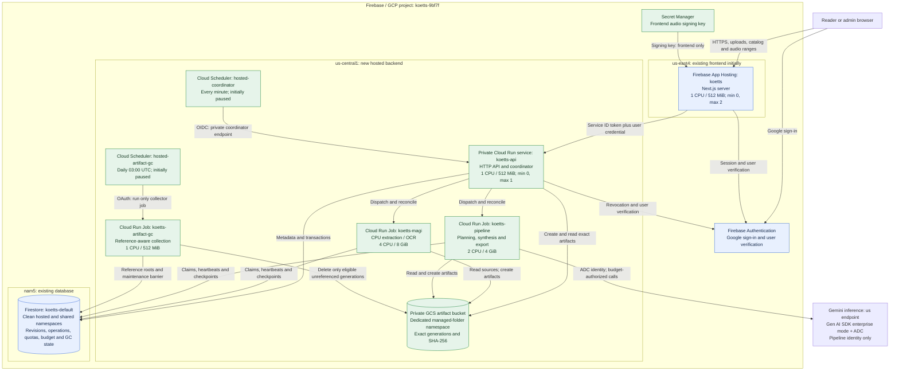
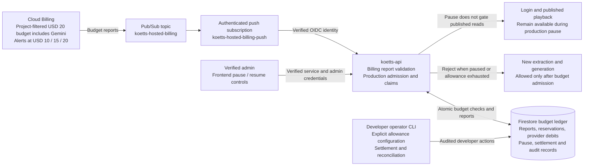
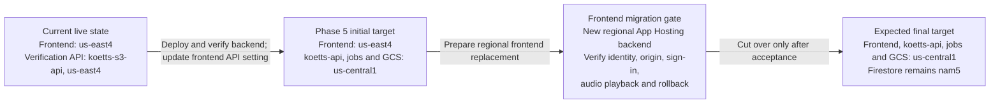

# GCP architecture — phase 5 hosted infrastructure

This is the intended deployment topology, not evidence that phase 5 is deployed.
It reflects the latest placement decisions: new API, jobs, Scheduler and artifact
storage in `us-central1`; existing frontend in `us-east4` initially, followed by
its planned migration to `us-central1`. The existing Firestore database remains
in `nam5`. Live rollout and paid validation still require separate authorization.

## Application and data paths

Solid connections show intended application calls or data access. The API is
private: the browser reaches it through the Next.js server, using independent
service and Firebase user credentials. Project-scoped managed services appear
outside the regional boxes because this diagram does not assign them a regional
location. Resource names without a fixed value are selected during preflight.

Blue nodes are existing services; green nodes are planned resources. Their arrows
describe the complete hosted path after acceptance, not the frontend's current
frontend-only mode. App Hosting includes its managed edge/CDN infrastructure,
which is collapsed into the frontend node for readability.

Published audio travels from private GCS through the API and the same-origin
frontend response to the browser. Every audio and range request checks the session
and publication. There is no public bucket or shareable GCS signed download URL.
Browser Firestore access is denied; backend SDK access uses IAM. Application
quotas, ownership and admin checks still apply inside the API.

Each job has one task, parallelism one, zero platform retries and a 30-minute
attempt timeout. The application allows at most three attempts and one global
slot per production stage. An uncertain provider outcome holds capacity until
reconciled; it does not trigger a blind paid retry. The collector removes only
unreferenced temporary artifacts older than seven days, preserving accepted and
referenced artifacts.

## Billing and operational controls

This diagram expands the API and Firestore roles shown above. Billing notification
delivery is asynchronous. The budget is project-filtered and alert-only; the
application's production pause preserves identity and published playback.

New production pauses at USD 15 reported project cost plus conservative retained
reservations, or earlier when an admission would exhaust allowance. The project
budget includes Gemini; the separate application provider allowance controls
admission and does not change billing attribution. These controls do not guarantee
a monthly bill ceiling:
builds, retained storage, playback and existing executions can continue charging.

## Staged frontend migration

The final target includes a frontend in `us-central1`. Keeping the current frontend
initially avoids combining backend acceptance with the frontend region cutover.
The existing `koetts-s3-api` remains the authentication verification target until
the new API is accepted and callers move; it is not a component of the final
production topology.

The initial frontend-to-API path crosses regions. Co-locating API/jobs and GCS
removes the intended bucket-to-worker region mismatch; it does not make every
service or transfer free. The later frontend backend may have a different generated
website URL and runtime identity. Capture actual values and verify Firebase
authorized domains, public origin, session behavior, API invocation and secret
access before redirecting users. Preserve the old frontend until rollback is
proven. No current website URL is changed by these diagrams.

## Configuration and ownership map

| Component | Configuration or source of truth |
| --- | --- |
| New regional compute and Scheduler | `infra/hosted/variables.tf`: `region = "us-central1"` |
| New artifact storage | `artifact_bucket_location = "us-central1"`; explicit bucket name and namespace required |
| API name and identity audience | `api_service_name = "koetts-api"`; `canonical_api_url` must match actual deployed URL |
| Dedicated workload identities and IAM | `infra/hosted/main.tf`; runtime GCS create/read versus collector read/delete grants |
| Existing frontend | `apps/web/apphosting.yaml`, `firebase.json` and deployed App Hosting backend; outside Terraform management |
| Existing Firestore | `firestore_database_id = "koetts-default"`; Terraform does not create or relocate the database |
| Gemini identity and signing secret | Pipeline uses Gen AI SDK enterprise mode and ADC with inference IAM; frontend signing value/version remains a separate operator input |
| Immutable container images | Explicit `api_image`, `magi_image`, `pipeline_image` digests; image builds and registry setup are outside this Terraform |

IAM limits Firestore workload access to the named database, not individual
collections. Application ownership, namespace bindings, fencing and admin checks
provide the finer boundaries. The frontend identity, production workers,
coordinator caller, billing push caller, collector caller, collector and operator
have distinct permissions; the diagram groups these identities into their workloads.

See [infrastructure configuration](../docs/resources/hosted-infrastructure.md),
[hosted plan](../docs/plans/hosted-service-plan.md), [rollout and migration](../docs/resources/hosted-rollout.md),
[cost controls](../docs/resources/hosted-cost-controls.md), and [free-tier assessment](../docs/research/hosted-free-tier-review.md).
